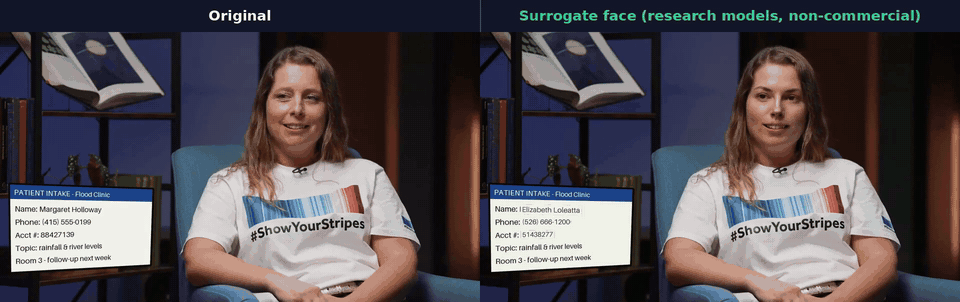
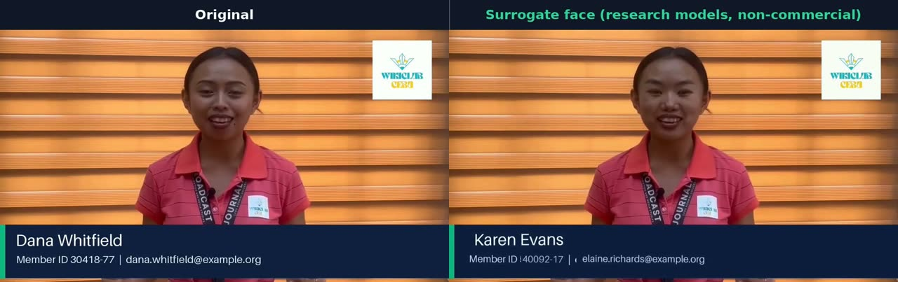
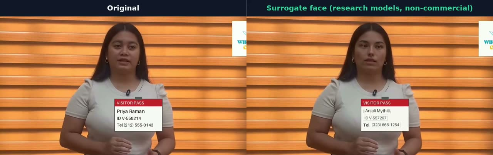
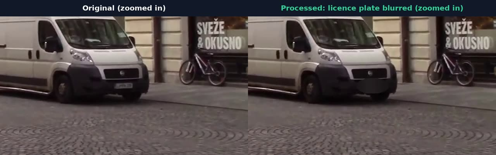
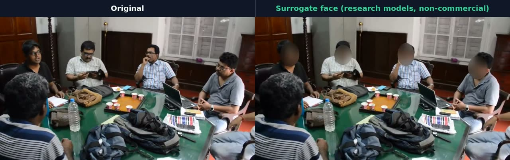

# Custodian Video Guardian (prototype)

This prototype de-identifies video **entirely on the local machine by default**. Nothing is sent to a cloud API: every model runs from local weights (ONNX Runtime, TorchScript, CTranslate2 or diffusers), the LLM is an Ollama server on `localhost`, and the scene-context VLM runs from the local Hugging Face cache.

The only exception is opt-in: `--pii-backend guardian|both|guardian-replace` sends OCR lines and the speech transcript to the **Custodian Guardian Layer** (see [Guardian Layer backend](#guardian-layer-backend-for-the-text-channels)). Guardian Layer can be deployed on-prem (confirmed by the vendor), which keeps the whole pipeline local. In this repository the hosted API is used only for research on the synthetic or public demo data.

It carries the Guardian Layer idea from text over to video. The same two modes exist:

| Mode | Faces | Licence plates | On-screen text PII | Spoken PII |
|---|---|---|---|---|
| `redact` | Heavy mosaic+blur, pixelate, or solid box (elliptical) | Blur, pixelate or box | Black box (or blur/pixelate) over **only** the PII words | 1 kHz bleep over the PII words |
| `transform` | **One consistent synthetic surrogate face per track** (SD-1.5 img2img keyframe, warped onto the face every frame). Faces under 64 px or with detection score under 0.6 get the blur instead. | Blur (no surrogate plates yet) | **The same field re-typeset with a same-type fake value** (e.g. `Name: Margaret Holloway` becomes `Name: Samuel Tanaka`) | **The same-type fake value spoken with local TTS** in the same time slot |

Surrogates are deterministic per original value. The same fake name therefore replaces the name everywhere, both on screen and in the audio track.

The web demo uses the opt-in research backend `--face-backend research-swap` instead. It renders a photoreal synthetic identity with RealVisXL, picks it with Qwen3-VL to match the person's apparent gender presentation, age band and skin tone, swaps it in with HyperSwap and checks every frame with SFace. Any frame that can still be matched to the person is blurred (fail closed). These models carry research-only or non-commercial licences (see [Examples](#examples)).

## Examples

Original on the left, `--mode transform --face-backend research-swap --pii-backend guardian-replace` on the right. All clips are openly licensed Wikimedia Commons footage. The personal details on the screens, captions and badges, and in the clip-1 audio, are synthetic and were planted for the demo. Interactive demo (switch methods, show what changed): https://custodianlabs.pages.dev/video



*Interview (clip 1). The face is replaced on every frame while expression and lip movement are kept. On screen, the name, phone and account number are replaced with same-type values from the Custodian Guardian Layer; "Topic" and "Room" stay readable. The spoken name and phone number are re-spoken with TTS. [Full side-by-side video](https://custodianlabs.pages.dev/video/compare/clip1_interview_synthpii_compare.mp4)*

| | |
|---|---|
|  |  |
| *Name caption (clip 4): the face, name, member ID and e-mail are replaced. [video](https://custodianlabs.pages.dev/video/compare/clip4_closeup_caption_compare.mp4)* | *ID badge (clip 5): the face, name, badge ID and phone are replaced; "VISITOR PASS" stays. [video](https://custodianlabs.pages.dev/video/compare/clip5_presenter_badge_compare.mp4)* |
|  |  |
| *Licence plates (clip 3, zoomed in): plates and passers-by are blurred. [video](https://custodianlabs.pages.dev/video/compare/clip3_traffic_plates_compare.mp4)* | *Low-resolution meeting (clip 6): every swapped face could still be matched to the person, so the identity check blurs them all (fail closed). [video](https://custodianlabs.pages.dev/video/compare/clip6_meeting_adults_compare.mp4)* |

Measured on the six demo clips (details in [`web/video/accuracy.json`](https://custodianlabs.pages.dev/video/accuracy.json)):

| Measure | Result |
|---|---|
| Real faces masked | 99.9% (1 partly visible face missed out of 1,678) |
| Sampled face masks that cover a real head | 71% (over-masking costs utility, not privacy) |
| Real licence plates masked | 100% (0 missed) |
| Planted PII caught: on screen / in speech | 9 / 9 · 2 / 2 |
| Non-PII text kept readable | 4 / 4 |
| Swapped faces matched to the person (clips 1, 4, 5; SFace, ArcFace, glintr100) | 0% |

The 481-clip benchmark (Kinetics-400, MOT17, VoxCeleb2) is in [Formal evaluation](eval/).

Every run also writes a **JSON audit log** of every detection. It records the track id, channel, type, frame range and time range, per-frame boxes with a `det`/`interp`/`pad` provenance tag, the score, the action taken, and the surrogate used. The log never stores raw PII: text is recorded only as a SHA-256 prefix plus a masked preview such as `M******* H*******`, unless you pass `--log-pii-text`.

## Pipeline

```
video ─┬─ pass 1 (analyse)
       │    faces  : EgoBlur face (Apache-2.0, TorchScript) every frame → boxes;
       │             YuNet on the crop → 5 landmarks (template fallback)
       │    plates : EgoBlur licence-plate model every 2nd frame (score ≥ 0.8)
       │    text   : RapidOCR (PP-OCRv5) every 0.5 s → PII spans from the selected backend
       │             (local LLM qwen2.5:7b + regex | Guardian Layer + regex | both)
       │             → word-level quads of ONLY the PII characters
       ├─ link + densify (tracking.py)
       ├─ scene-context gate (text tracks): Qwen3-VL-8B looks at frame + close-up;
       │    public signage / OCR noise stays visible, everything else is masked
       │    greedy IoU / centre-distance tracking, gap interpolation (≤0.6 s),
       │    ±3-frame padding (text: ±1 OCR stride), smoothing, 1.25× dilation
       ├─ transform prep: one surrogate face per track (SD-1.5 img2img, per-track seed)
       ├─ pass 2 (render): masks/surrogates → H.264 through an ffmpeg pipe
       ├─ audio: faster-whisper word timestamps → PII spans (same backend) → bleep / TTS surrogate
       └─ mux + audit JSON
```

The design choices behind this:
- **Two passes, run offline.** The file is analysed completely before anything is rendered. This makes temporal consistency straightforward: tracks are linked first, gaps are interpolated, and masks are padded around each track. Favouring recall this way stops faces flickering back into view on frames where the detector missed them.
- **Span-level text masking.** For on-screen text, the detection prompt and JSON span schema are the ones used in `systems/llm_openai_compatible.py` in the text benchmark.

## Install

```bash
conda create -p /data/qbao775/miniconda3/envs/custodian-video python=3.11 -y
PY=/data/qbao775/miniconda3/envs/custodian-video/bin/python
$PY -m pip install -e .                       # core (ONNX Runtime CUDA-12 build)
$PY -m pip install "nvidia-cudnn-cu12" "nvidia-cublas-cu12" "nvidia-cuda-runtime-cu12" \
                   "nvidia-cufft-cu12" "nvidia-curand-cu12" onnx
$PY -m pip install -e ".[transform]"          # torch + diffusers for surrogate faces
$PY -m pip install --no-deps "torchvision==0.20.1" --index-url https://download.pytorch.org/whl/cu121
                                              # EgoBlur TorchScript calls torchvision::nms
$PY -m pip install piper-tts                  # optional spoken surrogates (GPL-3.0!)
ollama pull qwen2.5:7b                        # local PII LLM

# EgoBlur weights (Apache-2.0), from Meta's official Hugging Face repo
mkdir -p ~/.cache/custodian_video/egoblur_gen1 && cd ~/.cache/custodian_video/egoblur_gen1
R=9c0b319ad09d0346e8294d7bf569593d3ab865c0
for f in ego_blur_face.zip ego_blur_lp.zip; do
  curl -L -o $f https://huggingface.co/projectaria/EgoBlur/resolve/$R/$f && unzip -o $f && rm $f
done   # sha256 of the zips: face 2240fd03…5889, lp d4811e08…1963 (see PROVENANCE.txt)

# Scene-context VLM: Qwen/Qwen3-VL-8B-Instruct in the local HF cache, run by any
# interpreter with torch + transformers>=4.57 (the custodian-video env pins 4.46 for diffusers):
export CUSTODIAN_VLM_PYTHON=/data/qbao775/miniconda3/envs/gemma4-rl/bin/python

# Optional Guardian Layer backend: pure-Python SDK (depends only on httpx)
$PY -m pip install custodian-labs   # here: copied from the gemma4-rl env's site-packages (v0.1.4)
# API key: CUSTODIAN_SDK_API_KEY in the environment or in ../.env (never logged)
```

Model weights download once into local caches. After that the pipeline runs offline, with `HF_HUB_OFFLINE=1`. The weights are:
- EgoBlur face and licence-plate TorchScript models (`~/.cache/custodian_video/egoblur_gen1`; override with `EGOBLUR_DIR`)
- YuNet (OpenCV zoo) for 5-point landmarks on EgoBlur face boxes
- Qwen3-VL-8B-Instruct for the scene-context gate
- CenterFace (inside `deface`) and the YOLOv9 plate detector, only for the fallback flags
- the PP-OCRv5 ONNX models
- whisper `small.en`
- SD-1.5, from the local Hugging Face cache

Environment notes for this host:
- The driver is CUDA 12.9, so use `onnxruntime-gpu==1.22` (the CUDA-12 build). Version 1.30 targets CUDA 13.
- Use the static ffmpeg from `imageio-ffmpeg`, because it includes libx264. The conda ffmpeg does not.

## Usage

```bash
export CUDA_VISIBLE_DEVICES=<a GPU with free memory>   # shared GPUs: check nvidia-smi
custodian-video in.mp4 -o out_redact.mp4    --mode redact
custodian-video in.mp4 -o out_transform.mp4 --mode transform \
    --tts-voice ~/.cache/custodian_video/voices/en_US-amy-medium.onnx
# options: --channels faces,plates,text,audio  --face-style blur|pixelate|box
#          --text-style box|blur|pixelate  --ocr-every 0.5  --llm-model qwen2.5:7b
#          --no-llm (regex only)  --device cpu  --sd-strength 0.75  --log-pii-text
```

New in v0.2:

| Flag | Default | Meaning |
|---|---|---|
| `--face-detector egoblur\|centerface` | `egoblur` | EgoBlur (Apache-2.0 weights). `centerface` is the v0.1 detector, kept as a research-only fallback. |
| `--face-landmarks yunet\|template\|none` | `yunet` | EgoBlur outputs boxes only. The surrogate-face backend needs 5 landmarks, so they come from YuNet run on the face crop, with a fixed in-box template as the fallback. `template` avoids YuNet altogether. |
| `--plate-detector egoblur\|yolov9` | `egoblur` | EgoBlur licence-plate model, or the v0.1 YOLOv9 model. |
| `--face-threshold`, `--plate-threshold` | EgoBlur 0.1 / 0.8 | CenterFace 0.35, YOLOv9 0.35. |
| `--scene-filter vlm\|none` | `vlm` | The scene-context gate for on-screen text (below). |
| `--vlm-model`, `--vlm-python` | `Qwen/Qwen3-VL-8B-Instruct`, `$CUSTODIAN_VLM_PYTHON` | The VLM, and the interpreter its worker runs in. |
| `--pii-backend local\|guardian\|both\|guardian-replace` | `local` | PII detection and surrogates for the two text channels (below). |
| `--guardian-max-calls N` | 500 | HTTP calls allowed per run. A persistent counter in `~/.cache/custodian_video/guardian_usage.json` also caps all runs together at 2,000 (`CUSTODIAN_GUARDIAN_TOTAL_CAP`). |
| `--face-fp-filter person\|none` | `person` | Person-context filter for face false positives (below). |
| `--face-fp-max-score` | 0.5 | Face tracks scoring at or above this always stay masked. |
| `--face-backend sd15-keyframe\|research-swap` | `sd15-keyframe` | `research-swap` (opt-in, **research-only models, non-commercial licences**): one synthetic identity per face track (Stable Diffusion portrait of nobody), swapped per frame with HyperSwap; original mouth kept; faces that still match the original (SFace guard) are blurred. See `custodian_video/surrogate_face_swap.py` and the survey, §11. Web demo: "Surrogate face · research models (experimental)". |
| `--guardian-cache PATH` | off | JSON cache of Guardian Layer results, keyed by SHA-256 of the text. **It stores rewritten text**, so enable it only for synthetic or public data. |

### Person-context filter for face false positives

EgoBlur at its recall-first threshold (0.1) also fires on dogs, plants, statues, façade ornaments, hands and van grilles; on the demo clips only about 61 % of sampled face masks were real heads. `person_filter.py` lets a face **track** go unmasked only when every signal agrees it is not a person's head; anything uncertain stays masked:

- (a) none of its detected boxes touches the **head region** (top 40 %, widened by 25 % of the width each side and raised by 15 % of the height) of any **person** box found within ±2 frames by a COCO person detector (run every 2nd frame in pass 1);
- (b) the YuNet recall net never contributed a detection to it;
- (c) its maximum EgoBlur score is below 0.5 (`--face-fp-max-score`);
- (d) no box lies within 3 % of the frame border (person boxes are truncated there);
- (e) it was detected on at least 2 frames, so a single missed person detection never decides alone; a single-frame track may only be unmasked when a confident (≥ 0.5) animal box contains it;
- (f) a second look on the exact detected frames, full frame plus a zoomed crop (6× the box, upscaled to 800 px), still finds no person head there.

Any error, a missing person pass or a missing frame keeps the mask. The VLM is never consulted. Unmasked tracks are **not** in `detections` (which lists masked regions only); they are listed under `face_fp_filter.unmasked` in the audit log (id, frames, times, score, reason, boxes; geometry only), and every kept track carries its `fp_filter` reason.

Measured on the six web-demo clips (`demo/web_accuracy.py`, 300 sampled masks per configuration): the filter left 28 of 199 Gen1 face tracks unmasked (17 of 138 with Gen2). Every one of the 45 distinct unmasked tracks was checked by eye (statues, van grilles, dogs, plants, façade ornaments, a shop sign, a flag, a camera bag; no person). Sampled Blur face-mask precision rose from 61.3 % [55.7, 66.7] to 68.0 % [62.5, 73.0], and from 59–63 % to 65–68 % in the other configurations. Real-face recall (99.9 %), confident-face coverage (100 %) and the set of missed reference faces were unchanged in all 36 outputs. The gain is modest because the rules are conservative: statues and ornaments seen once, anything near a person, near the edge or scoring ≥ 0.5 stays masked. The 481-clip benchmark (`eval/`) predates the filter.

Person detector: torchvision Faster R-CNN ResNet-50-FPN v2, `COCO_V1` weights (person and animal classes). Code BSD-3-Clause; the weights are trained on COCO 2017 (annotations CC BY 4.0, images Flickr under their own licences), and torchvision leaves checking the weights' terms to the user. No Ultralytics/AGPL code is used.

### Scene-context gate for on-screen text

OCR plus a PII detector cannot tell a name on a patient form from a shop name on a storefront. In v0.1, clip3 produced 11 such false "PII" tracks.

Before an on-screen text track is masked, `scene_context.py` shows a local VLM (Qwen3-VL-8B-Instruct) two images: the full frame with the OCR line outlined in red, and a close-up. The VLM answers one letter: document / screen or overlay / badge / whiteboard or note / licence plate / **public signage** / **not real text** (a clock face or window pattern misread by OCR) / other.
- Only *public signage* and *not real text* leave the text visible. Any other answer, or a VLM failure, keeps the mask, because privacy favours recall.
- There is one VLM decision per text track. Tracks left visible are still listed in the audit log with `action: kept_visible(scene_gate)` and the VLM category, for human review.
- The VLM needs transformers ≥ 4.57, so it runs in a worker subprocess (`--vlm-python` / `$CUSTODIAN_VLM_PYTHON`). Nothing leaves the machine.

### Guardian Layer backend for the text channels

`--pii-backend` selects who finds PII in OCR lines and transcripts, and who supplies the `transform` surrogates:

| Backend | Detection (masking uses the union) | Surrogates (transform) | Network |
|---|---|---|---|
| `local` (default) | local LLM (Ollama qwen2.5:7b) + regex | local same-type generator | none |
| `guardian` | Guardian Layer `sensitive_words` + regex safety net | Guardian Layer rewrite | Guardian Layer endpoint |
| `both` | Guardian Layer + local LLM + regex | Guardian Layer rewrite | Guardian Layer endpoint |
| `guardian-replace` (recommended with Guardian; web demo "Blur + Custodian Guardian Layer") | local LLM + regex, plus Guardian Layer spans with a digit or `@` | **Guardian Layer value when it is a complete same-format replacement**, else local same-type surrogate | Guardian Layer endpoint |

How Guardian Layer output is used (`pii.py`: `GuardianClient`, `PIIEngine`):
- **Recovering spans.** `GuardianLayer().deidentify_text_outputs(text, masking_type="transform", pii_entities=["ALL"])` returns rewritten text, not spans. The changed regions are recovered by token-level `difflib` alignment of the original and `outputs[0].text`, and mapped back to OCR word boxes and Whisper word timestamps through the same character offsets the local detector uses.
- **Which edits are used.** Guardian Layer sometimes rewrites non-PII words (on text: `judge`→`lawyer`, `USD`→`GBP`; see `docs/multidomain_results.md`, "Surrogate quality"). An edit is therefore used **only** when it overlaps a span flagged by the local detector or listed in Guardian Layer's own `meta["sensitive_words"]`. Other edits are ignored and counted (`guardian_edits_ignored_non_pii`).
- **Plausibility filter for Guardian-only spans.** Guardian Layer's own `sensitive_words` also contain non-PII. On the demo panel it flagged `PATIENT INTAKE`, `Flood Clinic`, `Phone`, `river`, `Room` and `next week`, and in speech it flagged `a great day`. A span that only Guardian Layer flags, with no local detector agreeing, is therefore masked only if it contains a digit or `@`, or if Guardian Layer really replaced it. Spans it left unchanged, or turned into an inflection (`Flood`→`Floods`, `Phone`→`Phones`), are dropped and counted. Without this filter, the union masked 9 text tracks on clip1 instead of 3 (`demo/outputs/v02_guardian_nofilter_clip1/`).
- **Safety net.** Guardian Layer also sometimes leaves sensitive values verbatim. Masking always uses the **union** of Guardian Layer spans and the local spans (regex in `guardian` mode; LLM plus regex in `both`), so a value Guardian Layer misses is still masked. If a Guardian surrogate repeats a token of the original, the local same-type surrogate is used instead.
- **Cross-channel consistency.** One surrogate registry per run, keyed by the format-free value, makes `(415) 555-0199` on screen and `415-555-0199` in speech get the same surrogate, re-formatted to each surface form.
- **Calls, caching and retries.** Results are cached per unique text (in memory, plus the optional on-disk cache). All new OCR lines of a frame go in **one** call, joined by newlines and split back through the alignment. HTTP 429 backs off 10 s, 20 s, and so on. Authentication failures disable the backend for the run and fall back to local detection, and the fallback is logged.
- **Audit log.** The audit JSON gets a `pii_engine.guardian_layer` block: HTTP calls, 429s, cache hits, budget skips, latency, spans found by each side, edits used or ignored, and verbatim leaks. Raw PII is never logged, and neither is the API key.

**`guardian-replace`: Guardian Layer supplies the values, the detectors decide where.** Added after the demo showed Guardian Layer rewriting `VISITOR PASS` to `TOURIST FAIL`, changing only the area code of a phone number, and flagging `Phone` and `next week`. Use it with `--mode transform` (the web demo adds `--face-mode redact`).
- **Where (spans).** The local LLM + regex spans, plus Guardian Layer `sensitive_words`. A Guardian span that overlaps no typed local span is kept only if it contains a digit or `@`. A Guardian span that does overlap one may extend it only over adjacent word characters, such as a surname next to a first name, never over a field label like `Phone:`. Edits Guardian Layer makes anywhere else in the text are never applied: only the span pixels and the span's speech words are replaced.
- **What (value).** Each span collects Guardian Layer candidates in this order: its `top1_replacements` entry for exactly this value; the value's words replaced one by one; then the aligned slice of the rewrite. `complete_replacement()` accepts the first candidate that is a real, complete replacement of the same type:
  - Digit values must keep the same number of digits, change more than half of them, and keep no run of 3 unchanged digits. The new digits are poured into the original format, so `(415) 555-0199` stays `(NNN) NNN-NNNN`.
  - E-mail addresses must be valid, with a new local part.
  - Names and other words must have the same number of words, letters only, and every word must be new (similarity under 0.6, no shared token).
  - Placeholders such as `[NAME]` or `wxxxxxxxx` are rejected.
  - Otherwise the local same-type surrogate is used. The reason is logged: `guardian_unchanged`, `guardian_partial`, `guardian_no_candidate`, `guardian_wrong_format`, `guardian_wrong_type`, `guardian_masking_artefact` or `guardian_unavailable`.
- **Consistency.** The value registry is shared by screen and speech. A value first seen with the fallback is upgraded if a later OCR frame yields a valid Guardian value. The registry is frozen before rendering, so speech always repeats the on-screen value.
- **Audit.** Every text track and speech event records `surrogate_source` (`guardian` or `local`) and `surrogate_note` (the fallback reason). `pii_engine.guardian_layer` adds `guardian_only_dropped_no_digit`, `candidates_rejected` and `fallback_reasons`. Text is logged only as hashes and masked previews.

**Deployment.** Guardian Layer can be deployed on-prem (confirmed by the vendor; point the SDK at it with `CUSTODIAN_MASKING_BASE_URL`), so a product can keep the whole pipeline local. The hosted API is used here only for research on the synthetic or public demo data.

The audit log is written to `out.audit.json`.

The pipeline degrades gracefully on a shared machine:
- If CUDA runs out of memory, Whisper and Stable Diffusion fall back to CPU.
- If Ollama returns a 5xx error, the call is retried and then falls back to regex-only detection. Each fallback is logged.
- If the VLM worker fails, every flagged text track stays masked.
- If Guardian Layer fails or the call budget is used up, detection falls back to the local backend.

## Demo and evaluation

`demo/run_demo.sh` reproduces everything (`OUT=`, `BACKEND=`, `CHANNELS=` select the variant):
- **Inputs** are in `demo/inputs/`. `SOURCES.md` lists the CC licences.
- **v0.1 outputs, audit logs and metrics** are in `demo/outputs/` (top level, CenterFace + YOLOv9, no scene gate).
- **v0.2 outputs, audit logs and metrics** are in `demo/outputs/v02/` (EgoBlur, scene gate, local PII).
- **PII-backend comparison** (text + audio channels only): `demo/outputs/v02_{local_textaudio,guardian,both}/`, summarised by `demo/compare_pii_backends.py` into `demo/outputs/pii_backend_comparison.json`.
- **Face-detector comparison** (faces only, same machine load): `demo/outputs/v02_face_sweep/`.
- **Before / redact / transform keyframes** are in `demo/keyframes/` (`v02_*` for v0.2).

The evaluation scripts are:
- `demo/evaluate.py`:
  - SFace re-identification rate and YuNet face-detectability (OpenCV-zoo models: SFace is Apache-2.0, YuNet is MIT)
  - OCR leakage and surrogate re-detection for on-screen text
  - Whisper re-transcription leakage and surrogate re-detection for audio
- `demo/vlm_check.py`: a local Qwen2.5-VL-7B visual judge used to spot-check keyframes, because no human reviewer was available.

Results are summarised in `../docs/video_masking_survey.md` (section 5).

## EgoBlur Gen1 vs Gen2 (demo clips, redact, faces + plates)

Coverage = share of independently detected (YuNet) reference faces that end up masked.

| Clip | Gen1 @0.10 (default) | Gen2 @0.674 (official) | Gen2 @0.30 | Gen2 @0.10 |
|---|--:|--:|--:|--:|
| clip1 interview: coverage / face tracks | 0.948 / 9 | 0.948 / 2 | 0.948 / 2 | – |
| clip2 street faces | 0.897 / 69 | 0.411 / 10 | 0.699 / 32 | 0.840 / 55 |
| clip3 traffic (9 ref. faces) | 0.556 / 82 | 0.000 / 1 | 0.333 / 19 | 0.778 / 41 |

- **Gen2's official threshold is too strict for de-identification.** It is tuned for Aria cameras and misses small street faces.
- **At 0.10 Gen2 is comparable to Gen1 with far fewer tracks**, i.e. fewer false positives.
- **Gen1 stays the default until the formal benchmark (`eval/`) compares them.** The demo set is too small to decide.
- **Outputs:** `demo/outputs/gen_compare/`.

## Licensing of the components used

| Component | License | Commercial note |
|---|---|---|
| **EgoBlur face + licence-plate models (default)**: Gen1 TorchScript `ego_blur_face.jit` / `ego_blur_lp.jit` from [huggingface.co/projectaria/EgoBlur](https://huggingface.co/projectaria/EgoBlur) @ `9c0b319` | **Apache-2.0** for code and weights. Verified on 2026-10-02: the official Meta repo carries the `apache-2.0` tag and its README says "open-source license (Apache 2.0) for both commercial and non-commercial use". | OK. Gen2 weights are also Apache-2.0. They come from the e-mail form at projectaria.com/tools/egoblur and are installed in `~/.cache/custodian_video/egoblur_gen2/`; `PROVENANCE.txt` there has the SHA-256 hashes. Use them with `EGOBLUR_DIR=~/.cache/custodian_video/egoblur_gen2`. Gen2 is a detectron2 TorchScript model and only runs through Meta's own predictor, so install the official package without its pinned deps: `pip install --no-deps git+https://github.com/facebookresearch/EgoBlur` (tested at `75144e1` with torch 2.5.1). Gen2's default thresholds are the official camera-rgb values: face 0.674, plate 0.745. |
| torchvision 0.20.1 (needed by EgoBlur TorchScript) | BSD-3-Clause | OK |
| torchvision Faster R-CNN R50-FPN v2 `COCO_V1` weights (person-context face filter) | Code BSD-3-Clause; weights trained on COCO 2017 (annotations CC BY 4.0, Flickr images under their own licences) | torchvision does not license the weights separately and leaves dataset terms to the user; commonly used commercially, but check with counsel. Not Ultralytics/AGPL. |
| YuNet (OpenCV zoo, landmarks for EgoBlur boxes) | MIT | Trained on WIDER FACE. It only places landmarks on boxes EgoBlur already found, but the same dataset caveat applies; `--face-landmarks template` avoids it. |
| CenterFace weights (via `deface`), fallback only | MIT | Evaluated on WIDER FACE, which is non-commercial. Research fallback (`--face-detector centerface`). |
| open-image-models plate detector, fallback only | MIT | Training data provenance is not stated (`--plate-detector yolov9`). |
| Qwen3-VL-8B-Instruct (scene-context gate) | Apache-2.0 | OK |
| Custodian Labs SDK `custodian_labs` 0.1.4 + Guardian Layer (optional backend) | Proprietary (subscription API key) | Opt-in. Hosted or on-prem. |
| RapidOCR / PP-OCRv5 | Apache-2.0 | OK |
| faster-whisper / Whisper weights | MIT | OK |
| Ollama qwen2.5:7b | Apache-2.0 | OK |
| `--face-backend research-swap` only: HyperSwap 1b 256 (FaceFusion assets), InsightFace ArcFace w600k_r50 (buffalo_l), BiSeNet face parsing (bisenet_resnet_34), XSeg (xseg_3) | ResearchRAIL; InsightFace non-commercial research licence; MIT code with non-commercial CelebAMask-HQ training data; GPL-3.0 | **Research only, not for commercial use.** Opt-in experimental backend; weights in `~/.cache/custodian_video/research_faces/` (not bundled). |
| Stable Diffusion 1.5 | CreativeML OpenRAIL-M | Commercial use is allowed, subject to use restrictions. Being replaced by a purpose-built surrogate generator. |
| ControlNet v1.1 depth (`lllyasviel/control_v11f1p_sd15_depth`, surrogate realism v2) | OpenRAIL | Commercial use allowed, subject to use restrictions. Keeps head shape / width; the depth map is blurred so identity details stay free. |
| Depth-Anything-V2-**Small** (depth map for the ControlNet) | Apache-2.0 | OK. (The Base / Large checkpoints are CC BY-NC 4.0: do not swap them in.) |
| `stabilityai/sd-vae-ft-mse` (SD decoder) | MIT | OK |
| Qwen3-VL-8B-Instruct (coarse face attributes for the surrogate prompt) | Apache-2.0 | Local. Attributes are kept in memory only, never logged. |
| LivePortrait code + human weights (re-enactment) | MIT | OK. The InsightFace detector / landmark files in the same repository are never downloaded or loaded. |
| piper-tts ≥1.3 | **GPL-3.0** | Optional plug-in only. Replace with an MIT/Apache TTS for a product. |
| Qwen2.5-VL-7B (evaluation only) | Apache-2.0 | OK |

## Known limitations

- **Surrogate faces.** Re-enacted by LivePortrait (`CUSTODIAN_FACE_MOTION=static` gives the old frozen warp). Surrogate realism v2 (default; `--surrogate-realism v1` or `CUSTODIAN_FACE_REALISM=v1` restores the pre-2026-10 behaviour) keeps the apparent age band, skin tone, hair and head shape and replaces only the inner face; see `docs/video_masking_survey.md` §10 and `experiments/face_e/`. Hair, ears and the face outline stay the original's, so a very distinctive hairstyle still carries some identity signal. Strong profile (> 50° yaw) falls back to the static surrogate; faces under 32/64 px are blurred.
- **Scene gate errors.** The VLM gate removed most signage false positives, but it can mis-file a non-text blob (on clip2, a dog's head that OCR read as "1X") as a "screen". Such tracks stay masked, which is the safe direction. The gate costs about 12–60 s per clip on a shared GPU, mostly model loading.
- **Guardian Layer quality on video text** (measured on the demo, see `docs/video_masking_survey.md` §8). It flags field labels and benign phrases ("Phone", "Flood Clinic", "a great day"). It "transforms" some of them into inflections ("Phones", "Floods"). It changed the planted phone number only partially ("(414) 555-0199"), and it never flagged the planted account number. The plausibility filter, the leak check and the local safety net handle these cases, but `guardian` alone is not a safe configuration.
- **Unmasked frames when OCR starts late.** OCR runs every 0.5 s, and masks are extended backwards by one stride so text that appears between samples is still covered. Text that moves fast inside a single stride relies on interpolation.
- **Detection gaps.** EgoBlur (Gen1 weights) misses some heavily defocused small faces that CenterFace caught. At threshold 0.1, clip2 coverage of YuNet reference faces is 89.7% versus 91.2% with CenterFace. EgoBlur does not fire on back-of-head views, which CenterFace masked. The face model also fires on van fronts and sculptures, and the plate model fires on dark grilles at scores below 0.8. These false positives are blurred, which is harmless in `redact`; in `transform`, faces under 64 px or with score under 0.6 get a blur rather than a surrogate. There is no full-body anonymisation. Plates are detected every 2nd frame.
- **Speed.** EgoBlur is a Faster R-CNN X-101 model, at about 120–150 ms per 1080p frame on a shared A100 (CenterFace: 34–43 ms under the same load). With faces and plates, pass 1 is now dominated by detection. On this host (load average 300–550 on 256 cores during the runs), end-to-end throughput was about 1–1.5 fps for all channels and 3–6 fps for faces only. Batching frames, half precision, a fast tier distilled from EgoBlur, and NVDEC/NVENC are the obvious fixes.
