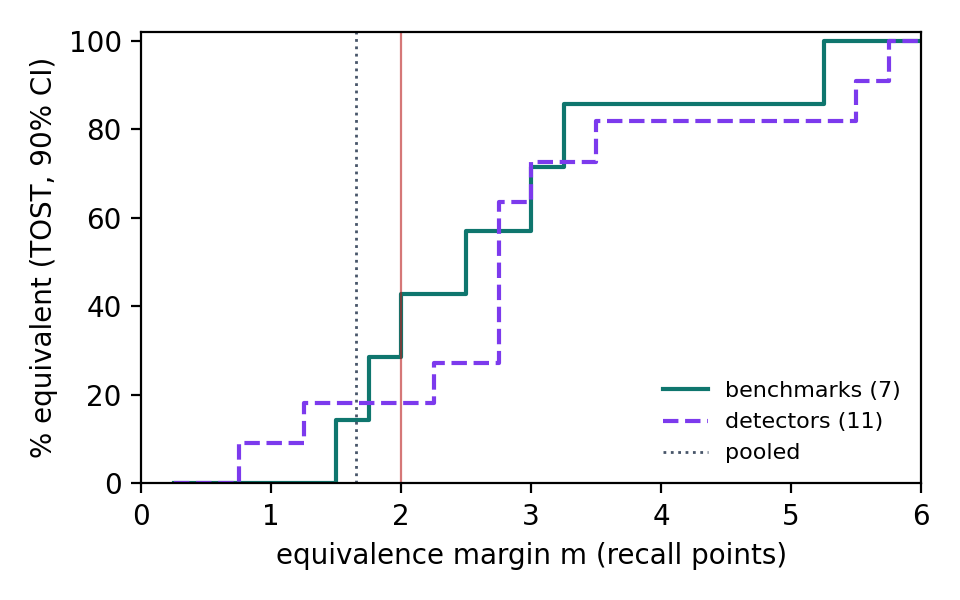

# Robustness of the paired masked-span change (E3, E6)

diff = recall(original) − recall(transformed), points (positive = loss). 90% CI: stratified document-level cluster bootstrap (B = 5000). Smallest margin = smallest m with the 90% CI inside (−m, m) (TOST, α = 0.05). `difflib` reproduces the paper; `snap_sym` is the corrected re-projection (see scripts/paired_core.py).

## E3. Re-projection × matching criterion (pooled, all detectors)

| Re-projection | Criterion | Spans × det. | Docs | Recall orig → transf. | Diff | 90% CI | Smallest margin | ±2 TOST |
|---|---|--:|--:|--|--:|--|--:|:-:|
| difflib | overlap | 57,112 | 1,147 | 76.1 → 74.9 | +1.22 | [+0.83, +1.62] | 1.62 | ✓ |
| difflib | iou50 | 57,112 | 1,147 | 68.1 → 66.1 | +1.96 | [+1.53, +2.39] | 2.39 | ✗ |
| difflib | exact | 57,112 | 1,147 | 59.4 → 53.9 | +5.45 | [+4.88, +6.02] | 6.02 | ✗ |
| difflib | exact_type | 57,112 | 1,147 | 56.5 → 51.0 | +5.46 | [+4.91, +6.02] | 6.02 | ✗ |
| snap_sym | overlap | 57,035 | 1,142 | 75.9 → 74.7 | +1.24 | [+0.84, +1.65] | 1.65 | ✓ |
| snap_sym | iou50 | 57,035 | 1,142 | 68.4 → 66.8 | +1.62 | [+1.20, +2.03] | 2.03 | ✗ |
| snap_sym | exact | 57,035 | 1,142 | 59.8 → 57.8 | +1.94 | [+1.50, +2.40] | 2.40 | ✗ |
| snap_sym | exact_type | 57,035 | 1,142 | 56.8 → 54.7 | +2.13 | [+1.71, +2.56] | 2.56 | ✗ |

### Per benchmark: smallest passing margin (points) by re-projection × criterion

| Benchmark | difflib overlap | difflib iou50 | difflib exact | difflib exact_type | snap_sym overlap | snap_sym iou50 | snap_sym exact | snap_sym exact_type |
|---|--:|--:|--:|--:|--:|--:|--:|--:|
| ASQ-PHI | +0.81 (1.37) | +1.82 (2.70) | +11.92 (13.72) | +12.03 (13.80) | +0.81 (1.36) | +1.69 (2.51) | +1.32 (2.43) | +1.50 (2.60) |
| MEDDOCAN | +1.86 (2.41) | +2.07 (2.66) | +4.36 (5.14) | +4.48 (5.24) | +1.88 (2.43) | +1.92 (2.49) | +2.13 (2.75) | +2.31 (2.91) |
| MultiCoNER v2 | +0.45 (5.19) | +10.45 (20.00) | +15.00 (25.91) | +14.09 (25.36) | +0.45 (5.19) | +7.27 (13.40) | +4.09 (7.73) | +3.64 (7.73) |
| PII en | +0.87 (1.84) | +2.84 (4.27) | +8.32 (10.34) | +6.70 (8.52) | +0.97 (1.97) | +2.35 (3.81) | +3.62 (5.13) | +2.58 (3.90) |
| PII nl | +1.92 (3.12) | +2.85 (4.45) | +5.80 (7.73) | +5.56 (7.31) | +1.86 (3.08) | +1.68 (2.96) | +1.52 (2.96) | +1.97 (3.31) |
| PII fr | -0.77 (2.47) | +1.12 (2.53) | +3.49 (5.20) | +3.76 (5.37) | -0.86 (2.80) | +0.31 (1.72) | +1.21 (2.65) | +1.77 (3.10) |
| PII de | -0.28 (1.55) | +0.24 (1.65) | +3.94 (6.58) | +4.82 (7.29) | -0.30 (1.61) | -0.23 (1.56) | +0.55 (2.00) | +1.58 (2.95) |

Cells: diff (smallest passing margin).

### Exact boundary: type-agnostic vs type-aware, by gold type (snap_sym)

| Gold type | Spans × det. | exact: orig → transf. (diff) | exact_type: orig → transf. (diff) |
|---|--:|--|--|
| NAME | 10,836 | 62.3 → 58.6 (+3.7) | 61.7 → 57.8 (+3.9) |
| DATE | 13,818 | 68.6 → 68.3 (+0.2) | 67.8 → 67.4 (+0.4) |
| AGE | 2,265 | 22.3 → 26.2 (-3.9) | 22.0 → 25.8 (-3.8) |
| SEX | 500 | 9.8 → 14.0 (-4.2) | 0.6 → 0.0 (+0.6) |
| LOC | 13,107 | 49.7 → 46.5 (+3.2) | 48.3 → 44.8 (+3.5) |
| ID | 6,844 | 65.7 → 64.3 (+1.4) | 58.6 → 58.0 (+0.6) |
| CONTACT | 8,930 | 68.6 → 65.2 (+3.4) | 61.6 → 58.1 (+3.6) |
| OTHER | 735 | 24.1 → 29.7 (-5.6) | 1.2 → 1.8 (-0.5) |

### Mapping quality (unique masked spans)

- Masked under difflib: 5,279; under snap_sym: 5,273.
- Re-projected surrogate boundary moved by snapping (difflib cut inside a word): 355 (6.7%); by benchmark {'ASQ-PHI': 85, 'PII nl': 27, 'MEDDOCAN': 142, 'PII en': 44, 'PII de': 26, 'PII fr': 28, 'MultiCoNER v2': 3}.
- Replacements difflib missed (masked only after snapping): 41; masked only under difflib (gold text ≠ document, excluded from snap_sym): 47.
- Examples, difflib → snapped surrogate: `#CH-34567` → `#CH-345678`; `Düs` → `Düssel`; `124-45-679` → `124-45-6790`; `1800` → `21800`; `Sanchez Caniza` → `Sanchez Canizales`; `el.gxxxxxxxxxxxxxxxxx@osakidetza.net` → `Raquel.gxxxxxxxxxxxxxxxxx@osakidetza.net`; `124-45-679` → `124-45-6790`; `0/02/2010` → `10/02/2010`
- Examples of replacements difflib missed, original → surrogate: `123456789` → `1234567890`; `12345` → `123456`; `123456789` → `1234567890`; `Colombia` → `Colombian`; `Colombia` → `Colombian`; `Colombia` → `Colombian`; `Colombia` → `Colombian`; `Bulgaria` → `Bulgarian`

Snapping is a heuristic correction; it is not the transform's own replacement offsets.

## E6. Equivalence margins (overlap criterion)

### difflib: per benchmark

| Benchmark | Spans × det. | Recall orig → transf. | Diff | 90% CI | Smallest margin | P(<1) | P(<2) | P(<3) |
|---|--:|--|--:|--|--:|--:|--:|--:|
| ASQ-PHI | 5,427 | 91.9 → 91.1 | +0.81 | [+0.24, +1.37] | 1.37 | 0.71 | 1.00 | 1.00 |
| MEDDOCAN | 31,978 | 73.4 → 71.5 | +1.86 | [+1.28, +2.41] | 2.41 | 0.01 | 0.66 | 1.00 |
| MultiCoNER v2 | 220 | 71.8 → 71.4 | +0.45 | [-4.31, +5.19] | 5.19 | 0.30 | 0.56 | 0.75 |
| PII en | 5,181 | 76.0 → 75.1 | +0.87 | [-0.09, +1.84] | 1.84 | 0.59 | 0.97 | 1.00 |
| PII nl | 3,757 | 78.2 → 76.3 | +1.92 | [+0.64, +3.12] | 3.12 | 0.11 | 0.55 | 0.93 |
| PII fr | 5,984 | 75.2 → 75.9 | -0.77 | [-2.47, +0.68] | 2.47 | 0.64 | 0.90 | 0.97 |
| PII de | 4,565 | 76.3 → 76.5 | -0.28 | [-1.55, +0.96] | 1.55 | 0.79 | 0.99 | 1.00 |
| POOLED | 57,112 | 76.1 → 74.9 | +1.22 | [+0.83, +1.62] | 1.62 | 0.17 | 1.00 | 1.00 |

### difflib: per detector (pooled over benchmarks)

| Detector | Spans × det. | Recall orig → transf. | Diff | 90% CI | Smallest margin | P(<2) |
|---|--:|--|--:|--|--:|--:|
| DeepSeek V2-Lite | 5,279 | 51.4 → 47.5 | +3.92 | [+2.29, +5.58] | 5.58 | 0.03 |
| OBI RoBERTa | 5,279 | 73.4 → 70.6 | +2.80 | [+2.21, +3.38] | 3.38 | 0.01 |
| Gemma 4 31B | 4,865 | 92.3 → 92.4 | -0.06 | [-0.65, +0.53] | 0.65 | 1.00 |
| Gemma 4 E4B | 5,279 | 87.6 → 85.7 | +1.84 | [+1.04, +2.66] | 2.66 | 0.63 |
| Llama 3.1 8B | 5,279 | 47.0 → 49.9 | -2.86 | [-5.32, -0.55] | 5.32 | 0.29 |
| Llama 3.3 70B | 4,736 | 90.7 → 89.4 | +1.33 | [+0.62, +2.03] | 2.03 | 0.95 |
| OpenAI GPT* | 5,279 | 89.6 → 87.7 | +1.89 | [+1.08, +2.75] | 2.75 | 0.59 |
| Presidio | 5,279 | 75.0 → 73.1 | +1.89 | [+1.22, +2.59] | 2.59 | 0.61 |
| Qwen 3.5 35B-A3B | 5,279 | 86.7 → 85.2 | +1.52 | [+0.58, +2.49] | 2.49 | 0.80 |
| Qwen 3.5 4B | 5,279 | 66.3 → 65.1 | +1.16 | [-0.40, +2.77] | 2.77 | 0.81 |
| Qwen 3.5 9B | 5,279 | 79.9 → 80.0 | -0.09 | [-1.03, +0.84] | 1.03 | 1.00 |

### snap_sym: per benchmark

| Benchmark | Spans × det. | Recall orig → transf. | Diff | 90% CI | Smallest margin | P(<1) | P(<2) | P(<3) |
|---|--:|--|--:|--|--:|--:|--:|--:|
| ASQ-PHI | 5,457 | 91.9 → 91.1 | +0.81 | [+0.24, +1.36] | 1.36 | 0.72 | 1.00 | 1.00 |
| MEDDOCAN | 32,172 | 73.3 → 71.4 | +1.88 | [+1.30, +2.43] | 2.43 | 0.01 | 0.64 | 1.00 |
| MultiCoNER v2 | 220 | 71.8 → 71.4 | +0.45 | [-4.31, +5.19] | 5.19 | 0.30 | 0.56 | 0.75 |
| PII en | 5,280 | 75.3 → 74.3 | +0.97 | [-0.02, +1.97] | 1.97 | 0.51 | 0.96 | 1.00 |
| PII nl | 3,808 | 77.2 → 75.3 | +1.86 | [+0.60, +3.08] | 3.08 | 0.13 | 0.58 | 0.93 |
| PII fr | 5,720 | 75.6 → 76.4 | -0.86 | [-2.80, +0.73] | 2.80 | 0.62 | 0.87 | 0.95 |
| PII de | 4,378 | 76.0 → 76.3 | -0.30 | [-1.61, +1.04] | 1.61 | 0.77 | 0.98 | 1.00 |
| POOLED | 57,035 | 75.9 → 74.7 | +1.24 | [+0.84, +1.65] | 1.65 | 0.15 | 1.00 | 1.00 |

### snap_sym: per detector (pooled over benchmarks)

| Detector | Spans × det. | Recall orig → transf. | Diff | 90% CI | Smallest margin | P(<2) |
|---|--:|--|--:|--|--:|--:|
| DeepSeek V2-Lite | 5,273 | 51.4 → 47.4 | +4.02 | [+2.37, +5.69] | 5.69 | 0.02 |
| OBI RoBERTa | 5,273 | 73.3 → 70.6 | +2.69 | [+2.10, +3.27] | 3.27 | 0.02 |
| Gemma 4 31B | 4,856 | 91.9 → 91.9 | -0.08 | [-0.70, +0.51] | 0.70 | 1.00 |
| Gemma 4 E4B | 5,273 | 87.3 → 85.4 | +1.90 | [+1.07, +2.73] | 2.73 | 0.59 |
| Llama 3.1 8B | 5,273 | 47.4 → 50.2 | -2.84 | [-5.27, -0.51] | 5.27 | 0.29 |
| Llama 3.3 70B | 4,722 | 90.6 → 89.2 | +1.40 | [+0.64, +2.15] | 2.15 | 0.92 |
| OpenAI GPT* | 5,273 | 89.3 → 87.4 | +1.92 | [+1.10, +2.76] | 2.76 | 0.56 |
| Presidio | 5,273 | 74.9 → 72.9 | +2.01 | [+1.30, +2.73] | 2.73 | 0.50 |
| Qwen 3.5 35B-A3B | 5,273 | 86.6 → 85.0 | +1.56 | [+0.57, +2.56] | 2.56 | 0.77 |
| Qwen 3.5 4B | 5,273 | 65.9 → 64.8 | +1.10 | [-0.48, +2.72] | 2.72 | 0.81 |
| Qwen 3.5 9B | 5,273 | 79.7 → 79.7 | -0.06 | [-1.01, +0.88] | 1.01 | 1.00 |

\* `openai_gpt`: the paper reports GPT-5; which OpenAI model produced these runs is under audit (see docs/reproducibility_audit.md).

Margin curve (snap_sym, overlap): share of benchmarks / detectors whose 90% cluster-bootstrap CI lies inside (−m, m).

## Second-pass detector framing

On the spans the transform replaced, a detector run after substitution misses 25.3% of them, against 24.1% of the original values (+1.24 points, 90% CI [+0.84, +1.65]; relative increase in misses 5.2%). This concerns masked-span detectability only; it is not overall PHI exposure, which also depends on the transform's coverage (spans it did not replace stay verbatim).

